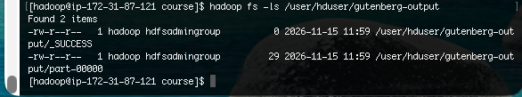

Ori Shtalhaim

## Exercise 1

I ran the word count program with the default settings and then again with `-numReduceTasks 6`.

| Counter | Default run | 6 reducers |
|---|---:|---:|
| Launched map tasks | 9 | 9 |
| Launched reduce tasks | 3 | 6 |
| Merged Map outputs | 27 | 54 |
| Partition files | 3 | 6 |

### How many files were created?

There were 3 partition files in the first run (`part-00000` to `part-00002`) and 6 in the second (`part-00000` to `part-00005`).

Both runs also created a `_SUCCESS` file, so there were 4 and 7 files in total.

### Did the number of mappers change?

No, there were 9 in both runs. The input splits did not change when I changed the number of reducers.

### Did the number of reducers change?

Yes, from 3 to 6, as requested by `-numReduceTasks 6`.

### Did the number of output files change? Why?

Yes. Each reducer writes one partition file, so the number of partition files increased from 3 to 6.

### What does "Merged Map outputs" represent?

It counts the map output segments merged by the reducers. In these runs, each reducer merged output from 9 mappers:

- 3 reducers: `9 × 3 = 27`
- 6 reducers: `9 × 6 = 54`

Code: [mapper](ex1/mapper.py) and [reducer](ex1/reducer.py).

## Exercise 2

I changed the mapper to use `.lower()` and `.rstrip(',.')`. This converts words to lowercase and removes commas and periods from the end of each word. I did not change the reducer.

For example, `The`, `the`, `the.` and `the,` are now counted together.

After the change, `Reduce input groups` went from 77,639 to 54,398.

Code: [mapper](ex2/mapper.py) and [reducer](ex2/reducer.py).

## Exercise 3

I changed the reducer and used the same mapper as in Exercise 2.

After counting each word, the reducer keeps the three highest counts in a heap. At the end, it prints them from highest to lowest.

I used `-numReduceTasks 1` to get the top three words for the whole input. With multiple reducers, each one would return its own top three.

The job ran with 9 mappers and 1 reducer. `Reduce output records` was 3.

Code: [mapper](ex3/mapper.py) and [reducer](ex3/reducer.py).

I ran this command from the directory containing the Exercise 3 scripts:

```bash
hadoop jar /usr/lib/hadoop/hadoop-streaming.jar \
  -file ./mapper.py -mapper ./mapper.py \
  -file ./reducer.py -reducer ./reducer.py \
  -input '/user/hadoop/gutenberg/*' \
  -output /user/hduser/gutenberg-output \
  -numReduceTasks 1
```

The output directory must not already exist when starting the job.

I used these commands to check the output:

```bash
hadoop fs -ls /user/hduser/gutenberg-output
hadoop fs -cat /user/hduser/gutenberg-output/part-*
```

| Word | Count |
|---|---:|
| the | 74279 |
| and | 42724 |
| of | 34526 |

No external sorting or filtering was needed to get these three results.

### Screenshots

Output files:



Top three words:


