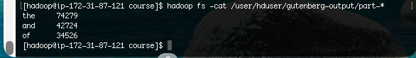

Ori Shtalhaim

## Exercise 1

I ran the original word count program twice: first with the default number of reducers, then with `-numReduceTasks 6`.

| Counter | Default run | 6 reducers |
|---|---:|---:|
| Launched map tasks | 9 | 9 |
| Launched reduce tasks | 3 | 6 |
| Merged Map outputs | 27 | 54 |
| Partition files | 3 | 6 |

### How many files were created?

The default run created 3 partition files, from `part-00000` to `part-00002`. The second run created 6, from `part-00000` to `part-00005`.

Each output directory also contained `_SUCCESS`, which is a status file rather than a data file.

### Did the number of mappers change?

No, both runs used 9 mappers. The input splits stayed the same, so changing the number of reducers did not change the number of mappers.

### Did the number of reducers change?

Yes, from 3 to 6, because I added `-numReduceTasks 6` to the second run.

### Did the number of output files change? Why?

Yes, from 3 to 6 partition files. Each reducer writes its own output file.

### What does "Merged Map outputs" represent?

It counts the map output segments merged by the reducers.

In these runs, the values matched the number of mappers multiplied by the number of reducers:

- Default run: `9 × 3 = 27`
- Second run: `9 × 6 = 54`

Code: [mapper](ex1/mapper.py) and [reducer](ex1/reducer.py).

## Exercise 2

I changed the mapper to convert words to lowercase with `.lower()` and remove trailing commas and periods with `.rstrip(',.')`. The reducer still sums the counts for each word.

This groups words like `The`, `the`, `the.` and `the,` under the same key.

`Reduce input groups` dropped from 77,639 to 54,398.

Code: [mapper](ex2/mapper.py) and [reducer](ex2/reducer.py).

## Exercise 3

The change is in the reducer. I kept the mapper from Exercise 2.

The reducer sums the count for each word and uses a heap to keep the three words with the highest counts. It then prints those three words in descending order.

I ran this job with `-numReduceTasks 1` so the top three are calculated across all words, rather than separately by each reducer.

The run used 9 mappers and 1 reducer, and `Reduce output records` was 3.

Code: [mapper](ex3/mapper.py) and [reducer](ex3/reducer.py).

From the directory containing the Exercise 3 scripts, I ran:

```bash
hadoop jar /usr/lib/hadoop/hadoop-streaming.jar \
  -file ./mapper.py -mapper ./mapper.py \
  -file ./reducer.py -reducer ./reducer.py \
  -input '/user/hadoop/gutenberg/*' \
  -output /user/hduser/gutenberg-output \
  -numReduceTasks 1
```

The output directory must not already exist before running the job.

I checked the files and printed the results using:

```bash
hadoop fs -ls /user/hduser/gutenberg-output
hadoop fs -cat /user/hduser/gutenberg-output/part-*
```

| Word | Count |
|---|---:|
| the | 74279 |
| and | 42724 |
| of | 34526 |

The top three are calculated inside the Python reducer, without external sorting or filtering.

### Screenshots

Output files:


Top three words:


